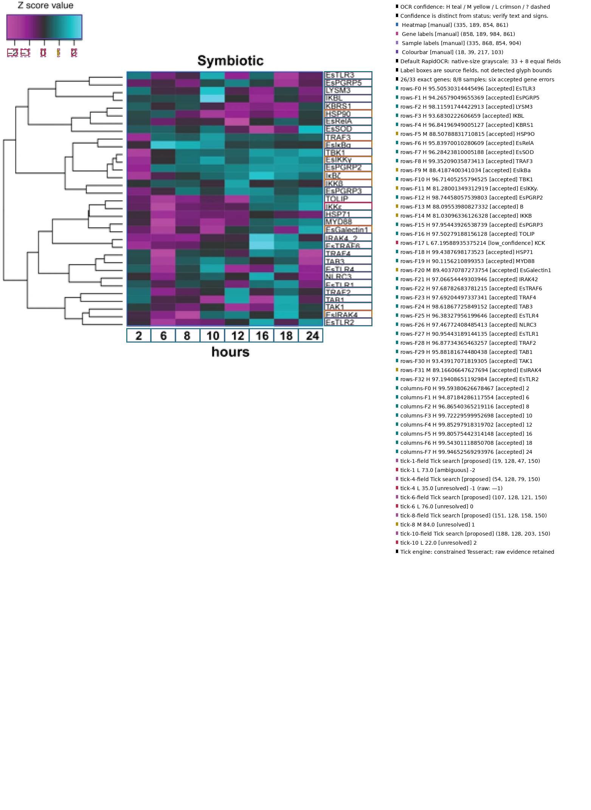
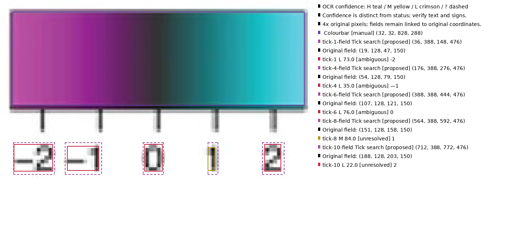

# heatmap-decoder

Recover **approximate displayed-scale tables** from mainly biological expression
heatmaps when the original matrix is unavailable. Expect genes on rows, samples
on columns, a regular rectangular grid and a separate continuous colourbar.
PNG/JPEG, sequential/diverging/grayscale palettes, bars on any side, and upright row labels
are supported. Sample labels additionally support explicit ±90° rotations.

**Current phase: M16 reviewed calibration and first publication-crop trial.**
Automatic regions and conditional count inference are implemented; default
operation produces review evidence. `--experimental-export` supports numeric-only
requests with supplied counts and supplied/reviewed linear or piecewise-linear
calibration when every image check passes. Piecewise calibration never extrapolates
outside reviewed anchors. Inferred counts, OCR scales and identifiers retain their
export restrictions. Stable release gates remain closed.
Arbitrary text angles, categorical legends, PDF and automatic numeric-model
selection remain unsupported. [M16 results](docs/progress/M16.md) report successful
partial reconstruction and the remaining publication ROI/OCR failures.

The scientific challenges matter:

- **Transformations are not invertible.** Row z-scores cannot recover original
  expression counts. Provenance names the recovered quantity, such as `row z-score`.
- **Saturated colours give possible bounds.** Values beyond the displayed range
  may be clipped; `quality.csv` marks endpoint matches as potential lower/upper bounds.
- **Compression and interpolation destroy information.** Unreliable cell colours
  produce flags or NaN. Matching errors and fit residuals are diagnostics, not
  calibrated uncertainty intervals or invented precision.
- **OCR needs human review.** `HSP70A`, `HSP70B` and `HSP70D` can be confused.
  Identifiers are never silently corrected, even at high engine confidence.

## Recognition in practice



The supplied **33-gene × 8-time-column Symbiotic crop** illustrates manual heatmap
(blue), gene (pink), sample (lilac) and colourbar (violet) regions. Titles and states
sit outside content in a readable ledger. OCR uses H teal, M yellow, L crimson
and ? dashed confidence frames; status words remain separate. This illustration
shows all 33 equal-pitch gene fields, eight sample fields and five aligned tick
fields. Gene/sample OCR now defaults to RapidOCR on native-size input; its slot
boxes describe source fields, not detected glyphs. The default trial recovers
`EsGalectin1` and **26/33 exact genes**, with **8/8 exact samples**. Six incorrect
gene readings still pass the existing confidence threshold, so identity review
remains necessary. Scores are engine-specific and uncalibrated. Earlier automatic
ROI trials abstained; this comparison uses explicitly supplied regions and counts.
Credit: Duscher, Vroom and Foster, Scientific Reports 14, 2912 (2024), CC BY 4.0.

The first completed reviewed numeric trial recovered 251/264 cells without
extrapolating beyond labelled ticks. Automatic ROI and composed requests abstained.
[Commands, full evidence and reconstruction limits](examples/m16/README.md) include
the retained failed first rendering attempt, tick errors and optional retry costs.
See [calibration and diagnostic conventions](docs/nonlinear-calibration.md).



Two-pixel tick-field padding recovers `-2`; a bounded margin retry recovers `1`.
Canonical proposals are now `-2`, `-1`, `0`, `1`, `2`: all five parse exactly.
Observed dash normalization retains raw text and audit actions; confidence and
conflicts still require review. All five fields are drawn even when recognition fails.
[Padding trial and limits](benchmarks/m16/ocr-padding/README.md).
[Numeric constraints and right-margin results](benchmarks/m16/numeric-signs/README.md)
retain the earlier Tesseract suffix failure. The
[default RapidOCR trial](benchmarks/m16/rapidocr-default/README.md) documents its
recovery and remaining errors.

## Try it

```bash
uv sync --locked --extra ocr
# RapidOCR labels/models are installed with the main package.
# Numeric tick OCR still needs local Tesseract + English data; see usage docs.
uv run heatmap-decoder automate examples/m12/figure.png \
  --request examples/m12/request.json --out work/automatic
uv run heatmap-decoder automate examples/corrections/figure.png \
  --request examples/corrections/request.json \
  --experimental-export --out work/decoded
uv run heatmap-decoder labels \
  examples/real_world/10.1038__s41598-024-53477-3__fig4.jpg \
  --config examples/m16/labels-default.json --out work/label-review
```

`automate` normally exits **5** with decisions, labelled diagnostics and tick
review files. Explicit experimental export exits **0** only within its validated
scope; see the [worked example](docs/automation.md#experimental-numeric-export).
The second command exports an experimental numeric example as `matrix.csv`,
per-cell `quality.csv` and provenance. Verify regions, scale and every identifier
for your own figure. Numeric-only/manual operation can run without OCR.

[Automation, slot OCR and overrides](docs/automation.md) ·
[Detailed usage](docs/usage.md) · [Scale review](docs/legend.md) ·
[Historical M12 evidence](docs/progress/M12.md)

MIT code; input figures retain their owners' copyright.

[Rotated sample labels and reviewed example](docs/rotated-labels.md) ·
[M13 results](docs/progress/M13.md) · [Specifications](docs/specs/) ·
[Milestone progress logs](docs/progress/)

[Observed palettes and ambiguity](docs/palettes.md) · [M14 results](docs/progress/M14.md) · [Geometry repairs](docs/progress/M14-repair.md) · [Orientation proposals](docs/orientation-proposals.md) · [M15 results](docs/progress/M15.md)
