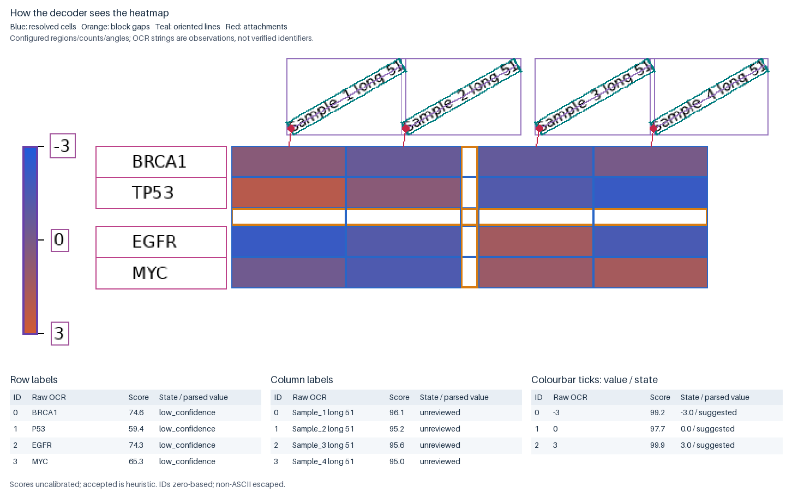

# heatmap-decoder

Recover approximate tables from raster heatmaps when the original matrix is
unavailable. The decoder matches cell colours against the observed colourbar and
recovers values on the **displayed scale**, such as a z-score—not original
expression counts.

It supports explicitly configured regular or blocked PNG/JPEG heatmaps, continuous sequential or diverging
colourbars, reviewed linear or piecewise-linear scales, and gene/sample label OCR.
RapidOCR with an English recognition model is the default label engine; sample labels support explicit finite angles
and complete-line attachment geometry. Arbitrary-angle identifiers require review.
Automation reports numeric completion separately from label review and can retain
positional numeric results. Linear OCR ticks use only their measured calibration
span. Automatic region/count detection remains experimental with bounded export gates.

## Quick start

From a checkout, install with [uv](https://docs.astral.sh/uv/) and run the bundled
synthetic example:

```bash
uv sync --locked
uv run heatmap-decoder extract examples/figure.png \
  --config examples/config.json --out work/example --fail-on-qc
```

Outputs include `matrix.csv`, per-cell `quality.csv`, diagnostic images and
`provenance.json`. For your own figure, supply or review the grid, colourbar,
scale and label regions using the [usage guide](docs/usage.md).

## Review the result

Compression, repeated colours, saturation and unreadable labels can make recovery
ambiguous. Unsupported or unreliable values receive flags or NaN. Inspect the
quality report and every identifier; OCR confidence does not verify gene identity.
Numeric tick OCR now also defaults to bundled English RapidOCR. Tesseract is an
optional fallback for other language packs and legacy comparisons.
RapidOCR can read all five ticks in the inspected publication with padded crops;
see the [OCR/blur diagnosis and tuning experiment](benchmarks/ocr-review/README.md)
for current failures, the endpoint-crop fix and numeric-engine comparisons.



This [reproducible synthetic example](examples/diagnostic/README.md) uses supplied
regions/counts and a +30° sample angle. The overlay shows resolved cells and the
row-group and column-group gaps; tables show actual row, column and colourbar OCR, including errors.
Heuristic acceptance and high scores do not mean identifiers have been reviewed.

## Documentation

- [Usage and installation](docs/usage.md)
- [Automation and review](docs/automation.md)
- [Capability decisions and positional numeric results](docs/confident-automation.md)
- [Arbitrary-angle sample labels](docs/arbitrary-angle-labels.md)
- [Blocked grid configuration](docs/blocked-grids.md)
- [OCR language and identifier character policy](docs/ocr-language.md)
- [Categorical group labels and published source tables](examples/real_world/README.md)
- [Grid tolerance and mild-blur diagnosis](docs/grid-tolerance.md)
- [Scale calibration](docs/nonlinear-calibration.md)
- [Worked examples](examples/README.md)
- [Validation evidence and limitations](benchmarks/README.md)
- [Documentation index](docs/README.md)

MIT-licensed code. Input figures retain their owners' copyright.

## Publication header examples

The existing `group-labels`, `labels`, `legend`, and `extract` workflows support
unnamed samples, multiple annotation tracks, tickless colorbars, short grouping
rules, and light/dark text in colored headers. See [usage and limits](docs/publication-headers.md)
and the [five additional real figures](docs/real-world-examples.md).
