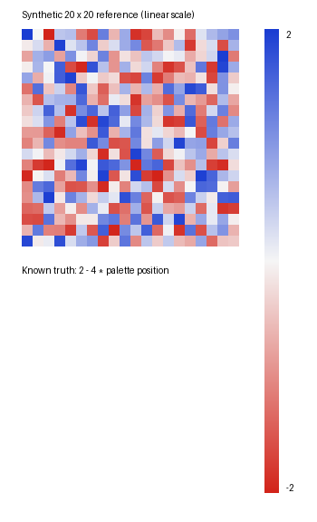

# heatmap-decoder — M5 development

Reconstruct an **approximate** numerical matrix from a PNG/JPEG heatmap and its
observed continuous, linear colourbar. Python 3.11+.

A deterministic Python library and command-line tool for semi-automatic reconstruction.
Supply the grid, heatmap/colourbar bounding boxes and endpoint values; inspect the
resulting QC before using the estimates scientifically. Supports sequential and
diverging palettes with continuous linear scales on Linux, macOS and Windows.

The optional local OCR adapter extracts upright horizontal gene/sample labels
from manually supplied regions, preserving displayed order and raw evidence.
See the [M5 example and review artifacts](M5.md), [M4 geometry API](M4.md), and
[migration note](MIGRATION.md). Labelled reconstruction and review import arrive
in M6. Numeric-only use requires no OCR dependency or engine.

```bash
uv sync --locked --extra ocr  # separately install Tesseract and English data
uv run --extra ocr heatmap-decoder labels examples/labels/clean.png \
  --config examples/labels/config.json --out review/
```

This writes label TSVs, an overlay, and provenance. Exit 4 leaves unresolved
slots for review; confidence is an OCR heuristic and accepted text can be wrong.

## Install and use

Install this development checkout into your own Python environment:

```bash
python -m pip install -e .
heatmap-decoder --version
```

For the bundled example and development tools, clone the development branch:

```bash
git clone --branch work https://github.com/kim-fehl/heatmap-decoder.git
cd heatmap-decoder
uv sync --locked
uv run heatmap-decoder extract examples/figure.png --config examples/config.json --out results/
```

The [bundled figure](examples/figure.png) is a clean synthetic 20 × 20 diverging
heatmap with known [truth](examples/truth.csv) and [configuration](examples/config.json).
Its generator uses a fixed seed and an independent analytic palette. Regenerate it
with `uv run python examples/generate.py`.



For your own figure:

```bash
heatmap-decoder extract figure.png --config config.json --out results/
```

Use `heatmap-decoder extract --help` for all options. `python -m heatmap_decoder`
provides the same CLI. Outputs are not replaced unless `--overwrite` is passed.
`--mask mask.npy` accepts a boolean H × W NumPy array saved with `numpy.save`;
`True` means missing. Object arrays/pickled input are not accepted. `--fail-on-qc`
writes outputs and exits 3 when any cell is flagged, for automated pipelines.
Exit 0 means outputs were written; exit 2 means invalid input or a filesystem error.
QC warnings appear on stderr even when `--fail-on-qc` is omitted.

Python API:

```python
from pathlib import Path
from heatmap_decoder import ExtractionConfig, extract_file

config = ExtractionConfig.model_validate_json(Path("config.json").read_text())
result = extract_file("figure.png", config, "results/")
```

Configuration follows this contract (QC fields are optional):

```json
{
  "heatmap_bbox": [100, 80, 500, 480],
  "colourbar_bbox": [550, 80, 575, 480],
  "rows": 20,
  "columns": 20,
  "colourbar_orientation": "vertical",
  "colourbar_start_value": 2.0,
  "colourbar_end_value": -2.0,
  "sampling_inset_fraction": 0.25,
  "max_colour_distance": 10.0,
  "ambiguity_colour_tolerance": 1.0,
  "ambiguity_position_fraction": 0.05,
  "minimum_valid_fraction": 0.5,
  "missing_colours": [],
  "missing_colour_tolerance": 3.0
}
```

Bounds are `[left, top, right, bottom]`, right/bottom exclusive, within the image.
Rows run top to bottom; columns left to right. Bar start means top for vertical
bars and left for horizontal bars, regardless of which endpoint is larger.
The bar ROI must exclude ticks, text and axial borders. Its first and last axial
pixel samples represent the stated endpoint values. All axial pixels are sampled;
the central half across the bar width is reduced by median. Cell sampling uses
pixel centres inside the inset interior, also reduced by median RGB. Empty
interiors fail clearly; lower the inset or use a finer raster.

## QC and missing data

Distances are CIELAB ΔE76 under D65: **colour matching diagnostics, not numerical
uncertainty intervals**. Thresholds are configurable heuristics, not calibrated
scientific confidence levels.

| Configuration | Default | Meaning |
| --- | --- | --- |
| `max_colour_distance` | 10 | Flag `POOR_MATCH` when nearest ΔE76 exceeds this |
| `ambiguity_colour_tolerance` | 1 | Candidate samples lie within best ΔE76 + this tolerance |
| `ambiguity_position_fraction` | 0.05 | Flag `AMBIGUOUS` when candidate positions span more than this fraction of the bar |
| `minimum_valid_fraction` | 0.5 | Minimum valid fraction of sampled interior pixels |
| `missing_colours` | empty | Explicit no-data RGB sentinels, e.g. `[[255, 0, 255]]` |
| `missing_colour_tolerance` | 3 | Maximum ΔE76 from a sentinel for a pixel to count as missing |

Repeated colours, broad flat/saturated plateaus and weakly identifiable regions
can trigger ambiguity. Adjacent similar colours on a smooth, identifiable scale
need not trigger it. Missing and ambiguous cells have `NaN` in `values` and the
matrix CSV. Unambiguous poor matches retain their estimates with `POOR_MATCH`.
Flags can combine. `inferred_values` preserves the nearest candidate for diagnosis;
it must not be treated as an ambiguity-resolved measurement.

Missing pixels come from a boolean mask (`True` = missing), nonopaque alpha
(including partially transparent pixels), or configured sentinel colours. No
colour, including black or white, is automatically missing. Remaining valid
pixels determine the median; cells below the coverage threshold are `MISSING`.
The colourbar's central sampling strip must be fully valid or extraction fails.

For in-memory use:

```python
from heatmap_decoder import CellFlag, extract, load_raster

image = load_raster("figure.png")  # uint8 RGB, or RGBA if transparency is present
result = extract(image, config, mask=None)  # optional boolean H × W mask
poor = (result.flags & CellFlag.POOR_MATCH) != 0
```

Core `extract` performs no I/O and is deterministic. Results contain matrices
`values`, `inferred_values`, `colour_distance`, `flags`, and `valid_fraction`;
`sampled_rgb` and `reconstructed_rgb` have shape `(rows, columns, 3)`.

## Outputs

`extract_file` reads source bytes once, computes hashes and writes:

- `matrix.csv`: headerless/indexless numerical matrix; `nan` marks missing/ambiguous cells.
- `quality.csv`: one row per cell, with zero-based row/column, ΔE76, flags, valid fraction and nearest candidate value.
- `provenance.json`: source filename/SHA-256, image shape, software version, complete configuration, QC thresholds, methods, flag proportions and optional mask SHA-256.
- `diagnostic.png`: source representative colours, nearest colourbar candidates and QC. Grey crossed cells are missing; purple is ambiguous; orange is poor; a black outline also marks poor matches when flags combine.

For a supplied mask, SHA-256 covers its boolean bytes in C order; retain the mask
alongside the input if you need to reproduce the extraction. Exports are
byte-reproducible for identical inputs with the same installed dependencies.
Read the matrix with `pandas.read_csv("results/matrix.csv", header=None)` when
using pandas. The file adapter prevents outputs from overwriting the input figure.

## Validation

```bash
uv run pytest -q -s
uv run ruff check .
uv run mypy src
```

CI runs these checks and the example CLI on Linux, macOS and Windows with
Python 3.11–3.14. It also builds the distributions and runs the installed wheel
in a fresh environment outside the source checkout. Hypothesis exercises geometry
and calibration invariants. CLI tests verify exit codes, masks, overwrite protection,
and pandas CSV reading.

Synthetic tests generate seeded 20 × 20 references independently of extraction,
using sequential and diverging palettes, both orientations, ascending/descending
endpoints and 4/9/16-pixel cells. They exercise PNG loading through CSV round-trip,
assert MAE <2% of the numerical range, and report MAE, maximum error and flagged
proportions. Clean references retain M1 accuracy with no flags.

QC tests cover masks/alpha/sentinels, partial coverage, all-missing matrices,
repeated colours, saturated endpoints, incomplete colourbars, provenance hashes,
combined flags, deterministic exports, gridline avoidance, JPEG compression and
blur. Degradation tests use a curved colour scale and explicitly stricter QC
thresholds; they verify increased colour errors/flags, not universal accuracy.

## Assumptions and limitations

Use a regular rectangular grid without perspective distortion or text in sampled
interiors. The colourbar must span the intended limits with a linear value scale.
JPEG and blur may change values without increasing colour distance if their
altered colours still lie on the observed colourbar. A small ΔE or no flag does
not guarantee an accurate numerical estimate. Endpoint matches cannot reveal
values clipped beyond the displayed limits; plateau detection cannot recover them.

These values approximate the figure's displayed scale, not exact measurements or
original pre-transformation biological values. OCR cannot establish biological
identity; labels need human verification. No automated ROI detection, rotated
text support, PDF support, web UI or inference of RNA-seq counts is included.

MIT licensed. Input figures remain copyrighted by their respective owners.


## Release packaging

```bash
uv build
uv run python tests/smoke_distribution.py
```

The wheel includes the typed Python package and console entry point. The source
distribution includes tests and the synthetic example. Version metadata has a
single source in `src/heatmap_decoder/version.py`. See [CHANGELOG.md](CHANGELOG.md).
The project has no PyPI publication configured; install this checkout locally.
A pushed `v*` tag publishes the wheel and source archive only after the entire cross-platform CI matrix passes; the tag
must match the package version. The release job uses GitHub Actions' built-in
repository token, with write access limited to that job.
