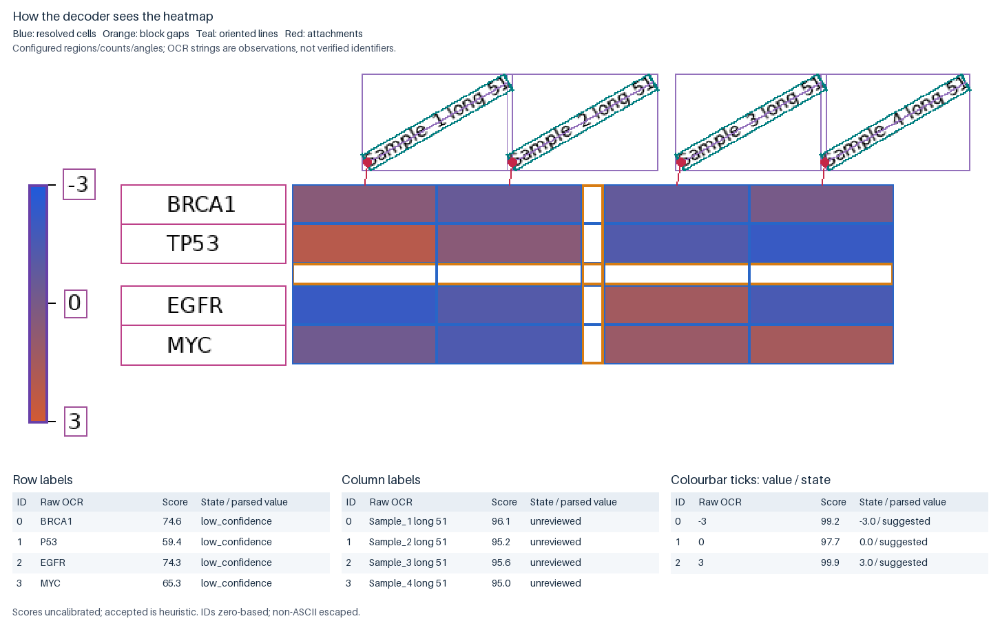

# heatmap-decoder

**Turn scientific heatmap images into machine-readable data.**

`heatmap-decoder` is an open-source Python toolkit for recovering approximate plotted values, labels and categorical annotations from raster heatmaps, especially gene expression figures, when the underlying matrix is unavailable. It combines image segmentation, colourbar calibration, optical character recognition (OCR) and explicit quality checks.

Built with NumPy, scikit-image, SciPy, Pillow and local RapidOCR, it runs without a hosted vision API.

## Helping AI agents read scientific figures

Scientific papers are increasingly searched and analysed with AI tools, but data-rich figures remain difficult to read precisely:

- An article may be available only as a PDF with low-resolution raster images.
- Supplementary files may omit the filtered, clustered or normalised matrix actually plotted.
- Reconstructing a display from deposited data may require undocumented gene selection, sample ordering or scaling.
- Captions alone rarely capture which genes vary together or which samples share patterns.

Heatmaps also vary widely in layout: multiple colourbars, annotation tracks, rotated labels, dendrograms and gaps complicate extraction. `heatmap-decoder` treats extraction as structured reconstruction, with diagnostics that expose ambiguous results for review.

## How it works

1. Uses configured regions or proposes matrix and legend locations.
2. Resolves the grid, including configured gaps and unequal blocks.
3. Matches cell colours to the observed colourbar and calibrates the plotted scale.
4. Recovers identifiers and annotations, including rotated sample labels.
5. Writes an approximate matrix, per-cell quality flags, provenance and diagnostic overlays, preserving unresolved values and labels for review.



*Reproducible [synthetic example](examples/diagnostic/README.md) with supplied regions, grid dimensions and sample-label angle. Actual OCR results, including errors, remain visible.*

## Quick start

Requires **Python 3.11+** and [uv](https://docs.astral.sh/uv/).

```bash
git clone https://github.com/kim-fehl/heatmap-decoder.git
cd heatmap-decoder
uv sync --locked

uv run heatmap-decoder extract examples/figure.png \
  --config examples/config.json \
  --out results/example \
  --fail-on-qc
```

The bundled synthetic example has known reference values. Extraction writes `matrix.csv`, `quality.csv`, `provenance.json` and diagnostic images. For your own figure, review the matrix boundaries, dimensions, colourbar, scale and labels using the [usage guide](docs/usage.md).

### Python API

```python
from pathlib import Path
from heatmap_decoder import ExtractionConfig, extract_file

config = ExtractionConfig.model_validate_json(Path("config.json").read_text())
result = extract_file("figure.png", config, "results/")
```

## Capabilities and limits

| Area | Current scope |
| --- | --- |
| Continuous colourbars | Sequential and diverging palettes; configured or reviewed linear and piecewise-linear scales |
| Grid geometry | Configured regular or blocked grids; experimental region and count proposals |
| Gene and sample labels | Local OCR and review; biological identity requires verification |
| Rotated sample labels | Quarter-turn and configured finite angles; arbitrary-angle identifiers require review |
| Categorical annotations | Reviewed row/column tracks, group labels and legend categories |
| Expression ranges | Reviewed value brackets, including open-ended ranges, without inventing point estimates |
| Competing panels or legends | Ambiguity diagnostics and review |
| Automatic extraction | Diagnostics by default; experimental numeric export under capability-specific constraints |
| Publication figures | General automatic reconstruction remains unvalidated across diverse held-out publications |

Dense or selectively labelled heatmaps may lack enough information to resolve individual cells or attach labels reliably. [Real-world examples](examples/real_world/README.md) document practical results and reference-data limitations.

The repository includes reproducible benchmarks, automated tests, strict type checks and CI configured across Linux, macOS, Windows and Python 3.11–3.14. [Validation reports](benchmarks/README.md) distinguish accuracy on accepted cases from overall coverage.

### Interpreting recovered data

- **Normalisation limits recovery.** Row z-scores cannot recover original expression counts or absolute differences between genes. Provenance records the recovered quantity.
- **Clipping limits precision.** Values beyond the displayed range may be saturated. `quality.csv` marks endpoint matches as possible bounds.
- **Image degradation creates ambiguity.** Quantisation, JPEG artefacts, blur and interpolation can produce flags or missing values. Matching errors are diagnostics, not calibrated uncertainty intervals.
- **OCR needs review.** Similar identifiers such as `HSP70A`, `HSP70B` and `HSP70D` can be confused. Identifiers are never silently corrected.

## Towards an AI-agent skill

The CLI, Python API and structured outputs provide a basis for a specialist tool in literature-reading workflows. An agent could request extraction, inspect the diagnostics and seek review where geometry, scale or identifiers remain unresolved. A packaged agent skill and autonomous integration are future goals.

## Documentation and examples

- [Installation, configuration and outputs](docs/usage.md)
- [Automation and review](docs/automation.md)
- [Blocked grids](docs/blocked-grids.md) and [rotated labels](docs/arbitrary-angle-labels.md)
- [Scale calibration](docs/nonlinear-calibration.md) and [range-valued extraction](docs/range-scales.md)
- [Real-world examples](examples/real_world/README.md)
- [Benchmarks and qualification](benchmarks/README.md)
- [Testing guide](docs/testing.md)

## Contributing

Contributions are welcome: licensed publication figures with independent reference data, detection and OCR improvements, palette support and agent interfaces. Reproducible failures are as useful as successful demonstrations.

## Licence

Code: [MIT](LICENSE). Input figures retain their original copyright and licence terms.
