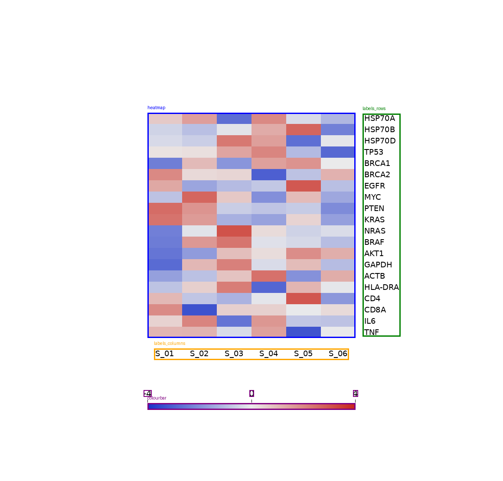

# heatmap-decoder

Recover **approximate displayed-scale tables** from mainly biological expression
heatmaps when the original matrix is unavailable. Expect genes on rows, samples
on columns, a regular rectangular grid and a separate continuous colourbar.
PNG/JPEG, sequential/diverging/grayscale palettes, bars on any side, and upright
horizontal labels are supported.

**Current phase: M12 with review corrections.** Automatic regions and conditional
count inference are implemented. Default automation produces review evidence;
`--experimental-export` enables numeric tables with supplied counts and a supplied
or reviewed linear scale when every image check passes. Inferred counts and OCR
scales still require export review. Stable release gates remain closed.
Rotated text, categorical legends, PDF and automatic nonlinear calibration are
unsupported. Decoded tables describe the plotted quantity, not exact measurements.
[Current validation and limits](docs/corrections.md) distinguish coverage from safety.

The scientific challenges matter:

- **Transformations are not invertible.** Row z-scores cannot recover original
  expression counts. Provenance names the recovered quantity, such as `row z-score`.
- **Saturated colours give possible bounds.** Values beyond the displayed range
  may be clipped; `quality.csv` marks endpoint matches as potential lower/upper bounds.
- **Compression and interpolation destroy information.** Unreliable cell colours
  produce flags or NaN. Matching errors and fit residuals are diagnostics, not
  calibrated uncertainty intervals or invented precision.
- **OCR needs human review.** `HSP70A`, `HSP70B` and `HSP70D` can be confused.
  Identifiers are never silently corrected, even at high engine confidence.

## Recognition in practice



This synthetic **20-gene × 6-sample** example shows the proposed grid in blue,
gene/sample regions in green/orange, and bar/tick text in purple. Genes can be
left/right, samples above/below, and bars horizontal/vertical on any side.
Region proposals do not verify biological identity. Tests include −4…4, −3…3,
−2…2, −4…2 and −3…4 scales, both directions, and 3–7 ticks.

A fragment of the actual [recognition evidence](examples/m12/recognition_evidence.json):

```json
{"automation": {
  "complete": {"status": "accepted", "evidence": {"experimental_only": true}},
  "automatic_export_allowed": false,
  "legend": {"fit": {
    "slope": 7.999988, "intercept": -4.002778,
    "recognised_span": [0.0, 1.0], "tests_linearity": true
  }}
}}
```

Ticks use measured stroke positions. Nearby horizontal numbers are grouped in
separate tick bands; three or more anchors must agree with a line and cover the
endpoints. Two ticks, unparsed signs and conflicting text need review. A known
grid can also use single-slot OCR for gene/sample strings.

## Try it

```bash
uv sync --locked --extra ocr
# Install local Tesseract + English data separately; see usage docs.
uv run heatmap-decoder automate examples/m12/figure.png \
  --request examples/m12/request.json --out work/automatic
uv run heatmap-decoder automate examples/corrections/figure.png \
  --request examples/corrections/request.json \
  --experimental-export --out work/decoded
```

`automate` normally exits **5** with decisions, labelled diagnostics and tick
review files. Explicit experimental export exits **0** only within its validated
scope; see the [worked example](docs/automation.md#experimental-numeric-export).
The second command exports an experimental numeric example as `matrix.csv`,
per-cell `quality.csv` and provenance. Verify regions, scale and every identifier
for your own figure. Numeric-only/manual operation can run without OCR.

[Automation, slot OCR and overrides](docs/automation.md) ·
[Detailed usage](docs/usage.md) · [Scale review](docs/legend.md) ·
[Historical M12 evidence](M12.md)

MIT code; input figures retain their owners' copyright.
