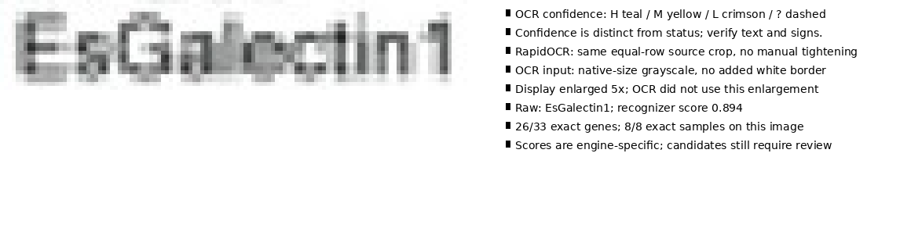

# Independent OCR comparison: Galectin suffix recovered

**RapidOCR reads `EsGalectin1` correctly from the existing equal-row crop.**
It requires no manually tightened box, gene dictionary, inserted suffix or
reference transcription. The strongest tested whole-axis recipe uses native-size
grayscale crops with no external enlargement or artificial white padding.

| Engine / input | Exact genes | Exact samples | Galectin raw text |
|---|---:|---:|---|
| Saved Tesseract baseline, 3× and 1px white padding | 9/33 | 8/8 | `EsGalectin` |
| RapidOCR, same prepared 3× row fields | 23/33 | not run | `EsGalecini` |
| RapidOCR, native-size source fields | **26/33** | **8/8** | **`EsGalectin1`** |
| RapidOCR, native-size + 4px white border | 21/33 | 8/8 | `EsGalectin1` |

The native trial adds 17 exact genes and loses none of the nine exact baseline
genes. The Galectin recognizer score is 0.894 without padding and 0.940 with padding.
The latter has worse overall accuracy, so choosing padding solely for the target
word would be misleading. These scores are engine-specific, not calibrated
probabilities and not comparable with Tesseract confidence.



The source crop is `[857,595,985,618]`. All 41 native/padded source boxes were
checked against the existing Tesseract slot-run boxes: they are identical.
RapidOCR uses its bundled PP-OCRv4 recognizer through ONNX Runtime on CPU, with
detector and orientation classifier disabled because the user-supplied grid
already defines individual fields. RapidOCR still performs its own internal
recognizer resizing; “native-size” means no additional application-level resize.

Seven genes remain wrong: `HSP9O` for `HSP90`, five Greek-letter-containing names,
and `IRAK42` for `IRAK4_2`. The last incorrect reading scores 0.971, illustrating
why a numeric confidence threshold alone cannot certify gene identity. All new
outputs are explicitly `needs_review`, with `final_text: null`. The source crop
box is recorded as a field, never as an invented detected-glyph box.

## Reproduce

The optional standalone candidate generator is
[`examples/m16/rapidocr_labels.py`](../../../examples/m16/rapidocr_labels.py).
It reads an explicit slot configuration and image; it never reads the evaluation
manifest, expected labels or vocabulary. It writes a separate experimental
candidate format, not an automatically accepted production label result.

```bash
uv venv work/m16/rapidocr-venv
uv pip install --python work/m16/rapidocr-venv/bin/python \
  -r benchmarks/m16/rapidocr/requirements.txt
work/m16/rapidocr-venv/bin/python examples/m16/rapidocr_labels.py \
  examples/real_world/10.1038__s41598-024-53477-3__fig4.jpg \
  --config examples/m16/labels-right-padding.json \
  --out work/m16/rapid-candidates-native.json
```

Add `--white-padding 4` to reproduce the padded comparison. `--upscale` defaults
to 1. These two experiment options override the configuration's OCR enlargement
and artificial white padding, while retaining its source margins and equal slots.
The isolated installation bundles the models; it does not send image data to a
remote OCR service or add a production dependency.

`native.json` and `pad4.json` retain raw readings, recognizer scores, original field
coordinates, settings, package versions and model/image SHA-256 hashes.
`summary.json` records exact-string evaluation, errors, gains and losses against
the saved baseline. `score.py` evaluates only after OCR and asserts identical crop
geometry. `render.py` regenerates the diagnostic. `galectin-probe.json` retains all
54 additional crop/resize/padding/detection alternatives, including failures;
`upscaled-probe.json` retains the first 33-row comparison. Matching scripts are
included, with scratch outputs under `work/m16`.

Both 41-field candidate runs completed, the selected candidate was reproduced,
all crop/count checks passed, and Ruff passed. Production extraction and numeric
calibration code are unchanged. This is inspected-image development evidence;
additional publications are needed before promoting an engine to a default.
