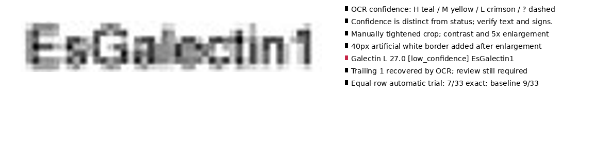

# Galectin suffix: white-border and crop experiments

The subsequent [RapidOCR comparison](../rapidocr/README.md) recovers the suffix
from the existing equal-row field and improves exact genes to 26/33, without the
manual tightening required by the Tesseract experiments below.

OCR recovered the exact raw string **`EsGalectin1`**, including the trailing `1`,
on the unchanged real-world JPEG. The best inspected candidate has confidence
**27/100**, below the existing acceptance threshold of 80. It remains a review
candidate (`final_text: null`); no reference-derived suffix was inserted.

The successful recipe is a manually tightened source crop `[859,597,976,617]`,
grayscale/autocontrast, 5× bicubic enlargement, then **40 output pixels of pure
white border on every side**, using Tesseract `--oem 1 --psm 8`. PSM 13 gave the
same string/confidence. PSM 7 also recovered the string, at confidence 16 with
contrast and 3 without. These are development observations on an inspected crop.
Padding after resizing differs from padding before resizing because interpolation
at the original crop boundary changes the input pixels.



Results from **235 probe calls**, plus one saved-candidate confirmation:

| Probe | Calls | Outcome |
|---|---:|---|
| Original full field: border widths 0,2,4,8,12,16; scales 3,4,6; PSM 7,8,13 | 54 | No exact Galectin recovery |
| Four inspected crops; eight preprocessing variants; PSM 7,8,13; 40px border after enlargement | 96 | 14 exact Galectin readings; best confidence 27 |
| Automatic dark-pixel bounding boxes; five thresholds; three margins; three borders | 45 | No exact Galectin recovery |
| Tight-crop border ablation plus a consistent inset across all 33 equal row fields | 40 | Tight crop with 16 source pixels of border recovered Galectin at confidence 12; uniform rule recovered 7/33 genes exactly, versus baseline 9/33, and missed Galectin |

The uniform-row comparison uses the same pre-existing row ownership. Its text
field is inset one pixel vertically from the unpadded equal slot raster bounds,
with horizontal bounds 859..983, border 8, and scale 5. Because it regressed exact
gene recognition, it is **not promoted to a general default**. Existing label
configuration, geometry, confidence thresholds and numeric reconstruction are
unchanged. Production label white padding remains bounded to 0..2; larger borders
here are isolated diagnostic experiments rather than a silent configuration change.

`recovered-candidate.json` retains complete raw engine token data, image hash,
crop/preprocessing and runtime identity. All outcomes, including failures and wrong
readings, are saved in the four probe JSON files. Reference gene strings are used
only to score the uniform-row outputs after OCR. No dictionary, gene whitelist,
alias correction, forced digit, or heatmap calibration participates in recognition.

Reproduce from the repository root (local Tesseract with English data required):

```bash
mkdir -p work/m16
uv run --extra ocr python benchmarks/m16/white-padding/border_probe.py
uv run --extra ocr python benchmarks/m16/white-padding/crop_probe.py
uv run --extra ocr python benchmarks/m16/white-padding/ink_probe.py
uv run --extra ocr python benchmarks/m16/white-padding/validate.py
uv run --extra ocr python benchmarks/m16/white-padding/save_candidate.py
```

Probe scripts write intermediate outputs under `work/m16`; the last script writes
the saved candidate and diagnostic above. Engine-sensitive readings may vary by
Tesseract version. Ruff checks and JSON/count consistency checks pass. This
follow-up changes diagnostic evidence only; it does not change production code.
