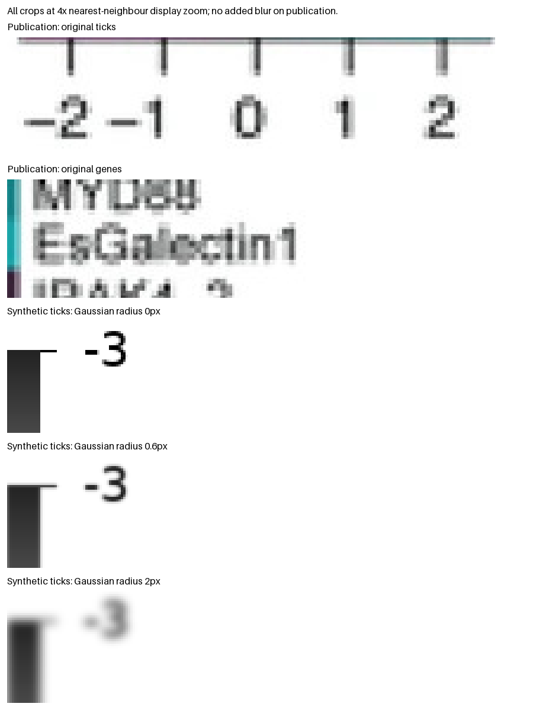

# OCR and blur review (2026-10-14)

These are **development probes**, not new held-out validation or a change to
export policy. Existing M16–M19 reports remain unchanged.

The follow-up [English model and character policy](../../docs/ocr-language.md)
now explicitly selects an English recognizer. The earlier numeric-crop results
below used the Chinese recognizer; `probe.py` pins that model and the legacy
Tesseract field producer to retain the comparison. `language.py` evaluates both recognizers on identical inputs.

## What still fails

The [M19 frozen summary](../m19/summary.json) separates the failure sources:

| Workflow | Clean | JPEG | Blur (0.6 px) |
|---|---:|---:|---:|
| Automatic geometry, reviewed scale | 40/40 | 11/40 | 3/40 |
| Automatic geometry and OCR scale | 39/40 | 11/40 | 3/40 |
| Supplied geometry/counts, OCR scale | 39/40 | 37/40 | 28/40 |
| Explicit numeric extraction | 40/40 | 40/40 | 28/40 |

Derivatives share the same 40 bases. Most degraded automatic failures arise
before OCR: `no_validated_grid`, uncertain outer bounds and broad boundary peaks.
Block separator inference requires sharp, independently supported endpoints;
blur leaves a white inner plateau but uncertain halo boundaries. Simply accepting
the plateau can change cell widths and counts. Do not relax that check without
measuring wrong accepted grids on negative cases.

Supplied geometry does not fix every numeric case: blur also changes the observed
colourbar/cell matching. In the new four-layout probe, one of 63 cells becomes
flagged/NaN already at radius 0.3, despite essentially unchanged finite-cell error.
That fails the complete-matrix criterion; a tiny finite-cell MAE alone hides it.

Correct label geometry does not establish correct spelling. M18 reported correct
geometry in all 126 clean/JPEG/blur attempts, but RapidOCR only 2/16 exact strings
in its four-angle spelling subset, including 14 confident errors. On the inspected
publication, the earlier default RapidOCR run recovered 26/33 genes and 8/8 samples;
six wrong genes passed its heuristic threshold. Spaces, underscores, digits and
short gene names remain vulnerable. See [M18](../m18/README.md) and
[M16](../m16/rapidocr-default/README.md) for their distinct scopes.

## Is the blur too strong?



The publication is a 1043 × 969 JPEG with visibly sampled/ringing glyph edges.
There is no clean reference from which to estimate its original Gaussian radius.
Low resolution, resampling, compression and Gaussian blur are different degradations;
one publication cannot establish a population of “typical” blur.

The older `examples/labels/generate.py` uses radius **2** for stress and **12** for
unreadability. Radius 2 is substantially softer than the displayed publication
letters; it should not be described as typical low resolution. Recent M18/M19
fixtures use **0.55/0.6**, respectively. At 0.6, the synthetic digits remain readable.
The mild test already exposes real geometry sensitivity, so weakening it would
hide that limitation. Keep the strong cases as stress tests and distinguish them
from mild degradation and real publication examples.

`blur-sweep.json` adds four paired development bases (one per block family),
reviewed scale, no OCR, and unchanged production decisions:

| Gaussian radius | Automatic complete/correct | Explicit complete/correct |
|---|---:|---:|
| 0 | 4/4 | 4/4 |
| 0.3 | 2/4 | 3/4 |
| 0.6 | 0/4 | 3/4 |
| 1.0 | 0/4 | 3/4 |

This small inspected sweep diagnoses sensitivity; it is not a success-rate estimate.

## Why two engines? Can RapidOCR read ticks?

Yes. The current split is an adapter/policy choice, not a fundamental inability:
RapidOCR is bundled and improved the publication's identifier OCR; Tesseract
provides a numeric character whitelist and the previously evaluated tick path.
The earlier adapter explicitly rejected RapidOCR `numeric_line`. That guard has
now been replaced with bounded RapidOCR numeric-field support. The RapidOCR wrapper
uses general PP-OCRv4 recognition, with no equivalent constrained decoder exposed.
Post-filtering letters is not the same as constraining model decoding and must not
turn an unrecognized glyph into an invented number.

`probe.py` bypasses that numeric-mode guard **only in this experiment**, calls
RapidOCR's existing field recognizer, and applies the unchanged strict number
parser. It uses production Tesseract-derived tick fields from the inspected
publication, so this is not an independent RapidOCR localisation/end-to-end test.
No model weights, character vocabulary, signs or truth labels are altered.

| Enlargement | White border in source pixels | Raw results in physical order |
|---|---:|---|
| 1× | 0 | `-2`, `-1`, `口`, `1`, `2` |
| 1× | 2 | `-2`, `-1`, `0`, `1`, `2` |
| 2× | 0 | `-2`, `-1`, `口`, `1`, `2` |
| 2× | 2 | `-2`, `-1`, `0`, `1`, `2` |
| 3× | 0 | `-2`, `-1`, `0`, `1`, `2` |
| 3× | 2 | `-2`, `-1`, `0`, `1`, `2` |

Two pixels of white padding recover **5/5**, with native-size input. The parser
rejects `口`; it is not silently substituted with zero. Padding/enlargement is a
promising deterministic candidate, not a reason for unlimited retries or picking
whichever reading makes a linear fit. `rapid-ticks.json` records every raw string,
score, source field, version and model hash, including failures.

Before making RapidOCR the numeric default, evaluate the same fixed preprocessing
on new signed decimals, exponents, tiny zero/one labels, both bar orientations,
clipped/missing signs, nearby text and contradictory ticks. Preserve independent
stroke positions: RapidOCR field boxes are input bounds, not detected glyph boxes.
Keep the strict parser, conflicting-alternative handling, budgets and calibration
span gates. RapidOCR is now the production tick default. Tesseract remains optional for
legacy comparisons and additional language packs; existing experimental OCR-scale
qualification remains tied to the previously evaluated Tesseract settings.

## Reproduce

```sh
uv sync --locked --group benchmark --extra ocr
uv run python benchmarks/ocr-review/probe.py
uv run python benchmarks/ocr-review/blur.py
uv run python examples/diagnostic/render.py
uv run python benchmarks/ocr-review/language.py
uv run python benchmarks/ocr-review/rapid_legend.py
uv run python benchmarks/ocr-review/rapid_legend.py --aligned
uv run python benchmarks/ocr-review/grid_tolerance.py
```

Tesseract with English data and DejaVu fonts must be installed. Probe results here
used RapidOCR 1.4.4 / ONNX Runtime 1.31.0; the model hashes are in the JSON report.
The scripts regenerate only this review's artifacts and the documentation figures.
Publication crops are derived from the repository's Scientific Reports figure,
[doi:10.1038/s41598-024-53477-3](https://doi.org/10.1038/s41598-024-53477-3), Fig. 4;
Duscher, Vroom and Foster, Scientific Reports 14, 2912 (2024),
[CC BY 4.0](https://creativecommons.org/licenses/by/4.0/). Changes: cropping and nearest-neighbour display
magnification, no additional publication blur. Source attribution/licence metadata
is in [M16 manifest](../../examples/m16/manifest.json).


## Follow-up: independent numeric fields and grid tolerance

The production RapidOCR pipeline now reads all 36 physical ticks in 12
clean/JPEG/blur development cases correctly, using its own detection and measured
strokes rather than Tesseract-derived crops. See `rapid-legend-current.json` and
`rapid_legend.py`. It parses all five publication ticks as well, though three
remain low-confidence review proposals. The latest README diagnostic uses only
RapidOCR for all three label sets.

The initial aligned-field experiment in `rapid-legend.json` failed all 12 cases.
Inspection showed cropped endpoint glyphs/signs: shared-band projection was clipped
to the bar's axial extent. The fix measures complete ink clusters within the search
ROI, including pixels beyond either endpoint; it never inserts a missing sign.
`rapid-legend-current-aligned.json` confirms all 36 endpoint-complete aligned-field
readings after the fix; four degraded cases still require review despite correct
raw strings. `rapid-legend-detected-fields.json` preserves the successful
detector-derived-field probe before production support. Earlier records remain intact.

[Grid tolerance diagnosis](../../docs/grid-tolerance.md) and `grid-tolerance.json`
show that all four 0.6-pixel-blur layouts already contain correctly grouped
proposals with every cell edge within one pixel of truth. Exact equality caused
no accepted-case failures in the frozen M19 report. The strict width/halo/bounds
acceptance checks cause production rejection before scoring. The new shared
benchmark metric permits 1.5-pixel boundary error while keeping counts and group
membership exact, and checks numeric recovery separately.
