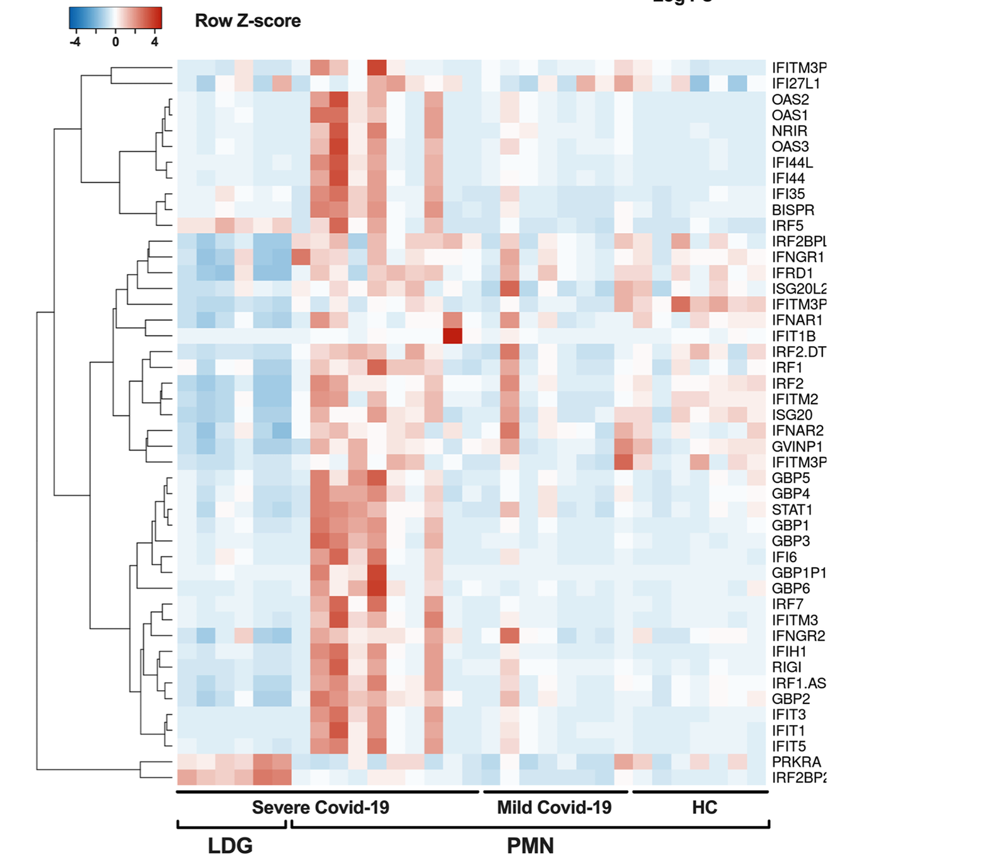
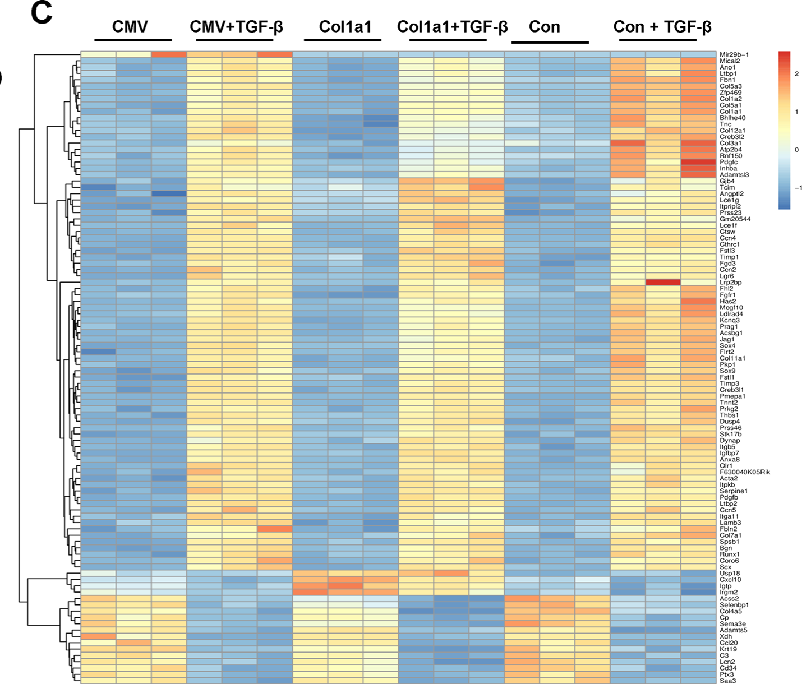
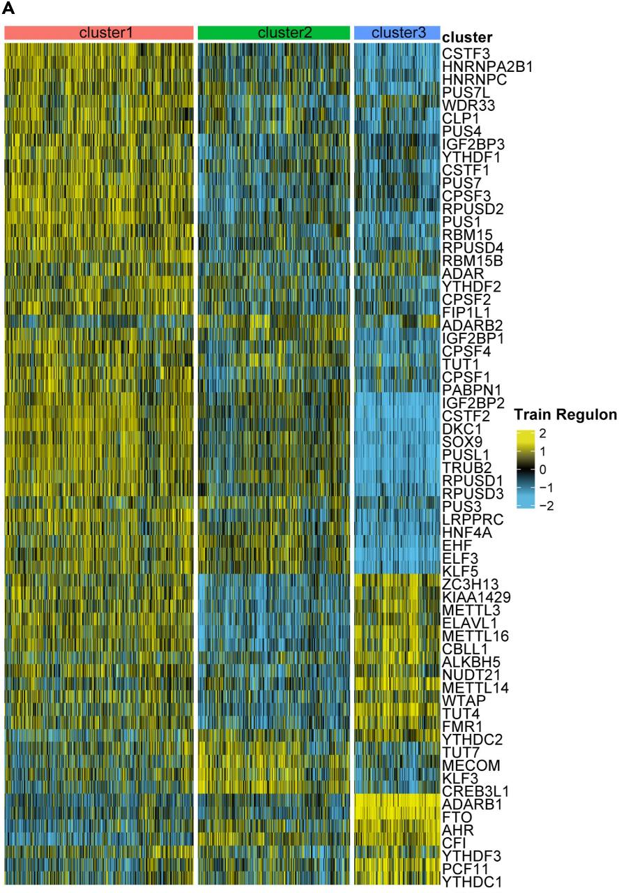
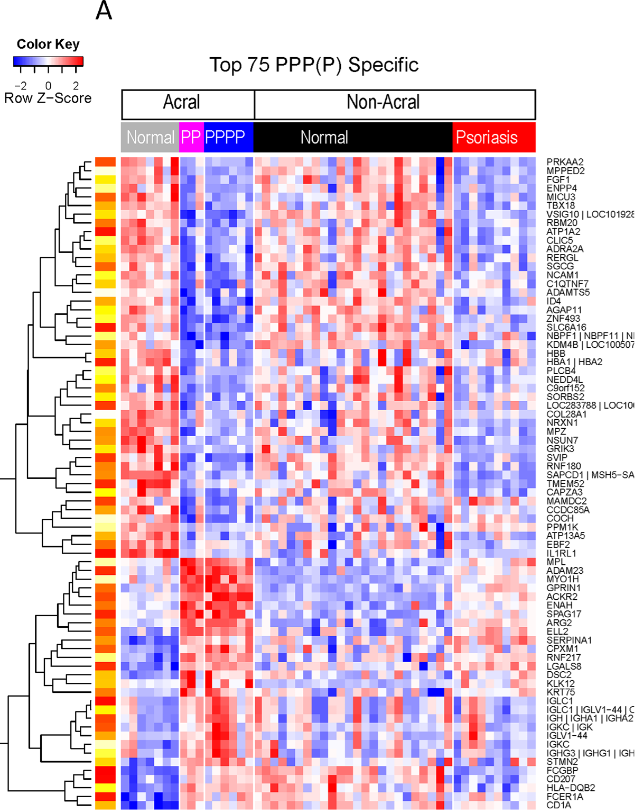
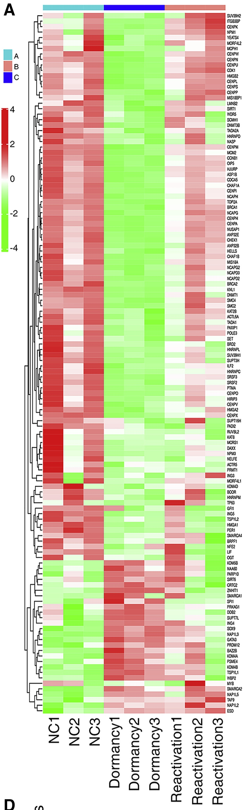

# Real-world examples

## COVID-19 neutrophil gene expression — Fig. 1C

Source: Cabrera et al. (2024), [The assembly of neutrophil inflammasomes during COVID-19 is mediated by type I interferons](https://journals.plos.org/plospathogens/article?id=10.1371/journal.ppat.1012368), Fig. 1C. Figure licensed under [CC BY 4.0](https://creativecommons.org/licenses/by/4.0/).

This example covers 31 sample columns without visible individual sample names and two rows of bracket annotations. Neither annotation row has a visible track title.

| Columns (1-based, inclusive) | Disease annotation | Cell annotation |
| --- | --- | --- |
| 1–6 | Severe Covid-19 | LDG |
| 7–16 | Severe Covid-19 | PMN |
| 17–24 | Mild Covid-19 | PMN |
| 25–31 | HC | PMN |

Expected decoder behavior:

- Preserve all sample columns even when sample labels are absent. Use positional internal IDs without inventing visible names or GEO identities.
- Recover category labels and their spans independently for each annotation row. The two partitions cross and cannot be represented faithfully as a single grouping hierarchy.
- Allow null track names; keep inferred meanings such as disease status and cell fraction separate from text actually visible in the image.
- Retain the row Z-score scale when describing extracted values.

Reference artifacts:

- [Annotation fixture](../examples/real_world/publication_headers/plos-ppat-1012368/figure-1c.annotations.json), with zero-based, end-exclusive spans.
- [GEO feasibility investigation](geo-ground-truth-feasibility.md).
- [Human GEO deposit: GSE272381](https://www.ncbi.nlm.nih.gov/geo/query/acc.cgi?acc=GSE272381).

Validation status: annotation reference only. The exact GEO sample subset, within-group sample order, and plotted numeric matrix remain unresolved. Do not use the deposited gene counts directly as ground truth for the image's Z-scores.

Implementation check: the existing `extract` workflow uses a reviewed 46 × 31 grid and visual colorbar anchors. `group-labels` reads both annotation rows and matches all reference spans. This does not establish GEO identities or biological numeric ground truth.

## miR-29b expression in fibroblasts — Fig. 7C, GSE158823

Source: Fan et al. (2020), [A strategic expression method of miR-29b and its anti-fibrotic effect based on RNA-sequencing analysis](https://journals.plos.org/plosone/article?id=10.1371/journal.pone.0244065), [Fig. 7C](https://doi.org/10.1371/journal.pone.0244065.g007). Figure licensed under [CC BY 4.0](https://creativecommons.org/licenses/by/4.0/).

This large, dense heatmap has 18 unnamed sample columns. Preserve the visible group text, including spacing, separately from normalized biological metadata:

| Columns (1-based, inclusive) | Visible group label |
| --- | --- |
| 1–3 | CMV |
| 4–6 | CMV+TGF-β |
| 7–9 | Col1a1 |
| 10–12 | Col1a1+TGF-β |
| 13–15 | Con |
| 16–18 | Con + TGF-β |

Expected decoder behavior and acceptance criteria:

- **No colorbar ticks:** locate each numeric label bounding box and project its center onto the colorbar's long axis. Use those centers as calibration anchors. Visible values run from 2 at the top through 1 and 0 to −1 below. The gradient extends beyond the outer labels, so its endpoints must not be assigned those label values automatically. Record whether anchors came from ticks or label centers.
- **Text wider than its column span:** match text to the corresponding group line using proximity and ordering. Text bounding-box width must not determine sample membership or cause overlapping groups.
- **Lines shorter than their groups:** use the reviewed matrix column grid, associate each line with its intended columns, and extend/snap the inferred span to column boundaries using neighboring groups as evidence. Do not require a line to fully cover a column. Here the result is six adjacent three-column groups covering all 18 columns exactly once; equal group sizes are a fixture expectation, not a universal inference rule. Flag ambiguous extension instead of silently absorbing columns from a neighbor.
- **Dense rows:** preserve narrow row spacing and recover row labels without merging neighboring genes. The decoder recovers 100 rows; the ordered gene labels are not fully verified.
- **Unnamed samples:** retain positional IDs and null visible sample labels; group text is not an individual sample name.

Reference artifacts:

- [Original uploaded crop](../examples/real_world/publication_headers/plos-pone-0244065/figure-7c.png).
- [Annotation and edge-case fixture](../examples/real_world/publication_headers/plos-pone-0244065/figure-7c.annotations.json), with zero-based, end-exclusive spans.
- [GSE158823](https://www.ncbi.nlm.nih.gov/geo/query/acc.cgi?acc=GSE158823): 18 mouse samples, with counts and FPKM in the listed supplement `GSE158823_count_FPKM_matrix.txt.gz`.

Implementation check: the existing decoder uses a reviewed 100 × 18 grid, reads all six groups and their correct spans, and reads colorbar values 2, 1, 0, −1 anchored at numeric label centers. Regression tests verify these results on the original image, including extension of the second short rule beyond its final sample center. Raw English OCR substitutes `B` for `β`; tests allow this explicit typographic substitution while outputs retain raw text.

Validation status: image extraction is tested; biological numeric ground truth and per-column GEO identities remain unverified. The paper describes using FPKM for this heatmap; do not assume deposited values directly equal the displayed scale. GEO file availability was checked via indexed metadata; the expression matrix was not downloaded or compared.

## Gastric cancer regulon activity — iScience Fig. 4A

Source: Zhang et al. (2024), [The implication of integrative multiple RNA modification-based subtypes in gastric cancer immunotherapy and prognosis](https://doi.org/10.1016/j.isci.2024.108897), [full text](https://pmc.ncbi.nlm.nih.gov/articles/PMC10839690/). Original user-supplied crop retained unchanged, CC BY-NC-ND 4.0.

The article's subtype training cohort implies **1,237 samples**: TCGA-STAD 350, GSE13861 64, GSE15459 192, GSE26899 93, GSE62254 283, Tianjin 90, GSE34942 56, GSE26901 109. Fig. 4A is labeled “Train Regulon.” This is a cohort-based inference, not independently verified panel membership. Exact per-cluster counts are unresolved.

This example tests labels **inside** discrete colored rectangles, with no separate legend: `cluster1`, `cluster2`, `cluster3`; the adjacent track title is `cluster`. Match each rectangle to its aligned matrix block and OCR its internal text after separating the fill from text. Keep the white block separators out of the sample data.

Implementation check: `group-labels` reads all three rectangle labels using supplied header boxes. With the article-inferred total of 1,237, columns would be subpixel within the roughly 628 horizontal pixels. The request remains incomplete, preserves raw header evidence, and assigns no individual sample names or spans. No numeric extraction configuration is provided for this unresolved case. Group sizes are not allocated proportionally to rectangle widths.

Reference: [annotation fixture and sample-count provenance](../examples/real_world/publication_headers/iscience-108897/figure-4a.annotations.json).

## Palmoplantar disease groups — PLOS ONE Fig. 4A, 0155215

Source: Bissonnette et al. (2016), [Based on Molecular Profiling of Gene Expression, Palmoplantar Pustulosis and Palmoplantar Pustular Psoriasis Are Highly Related Diseases that Appear to Be Distinct from Psoriasis Vulgaris](https://journals.plos.org/plosone/article?id=10.1371/journal.pone.0155215), [Fig. 4A](https://doi.org/10.1371/journal.pone.0155215.g004), CC BY 4.0.

The reference has 75 rows and 50 columns. Two annotation rows partition the same columns:

| Track | Visible label | Columns (1-based, inclusive) |
| --- | --- | --- |
| Skin site | Acral | 1–16 |
| Skin site | Non-Acral | 17–50 |
| Disease | Normal | 1–7 |
| Disease | PP | 8–10 |
| Disease | PPPP | 11–16 |
| Disease | Normal | 17–40 |
| Disease | Psoriasis | 41–50 |

The narrow magenta rectangle visibly contains `PP`; the article's biological category is `PPP`. Keep observed text separate from intended meaning. `Normal` occurs in two disjoint spans and must not be collapsed into a single group.

Expected and tested behavior:

- Read white text over gray, magenta, blue, black, and red fills. Choose text polarity from contrast with the rectangle background and OCR a normalized mask.
- Read the supplied black-on-white outlined site rectangles as a separate track above the filled disease rectangles.
- Snap rectangle boundaries to the regular matrix grid and preserve both partitions and their unequal group sizes.
- Use the reviewed horizontal color-key box and visual −2, 0, and 2 anchors, keeping the yellow/orange row annotation separate.
- Preserve the bottom margin in the reviewed 75-row grid.

Reference: [annotation fixture](../examples/real_world/publication_headers/plos-pone-0155215/figure-4a.annotations.json). Regression tests compare the original image extraction with these spans and labels, including all five light-text groups. Biological numeric ground truth and individual sample identities remain unresolved.

## Named samples and dense gene labels — Molecular Therapy: Nucleic Acids

Wang et al. (2021), [Chromatin accessibility regulates chemotherapy-induced dormancy and reactivation](https://doi.org/10.1016/j.omtn.2021.07.019), CC BY-NC-ND 4.0. [Article and test requirements](../examples/real_world/publication_headers/omtn-2021-07-019/article.json).

The ZIP preserves the original **939 × 3039**, **504,248-byte** JPEG unchanged.
The earlier inline attachments both arrived as identical 395 × 1280 images;
that reduced version is retained separately as `figure-3a-reduced.jpg`, never
substituted for the original evaluation input. Dimensions and SHA-256 are recorded
in `article.json` and tested.

The reviewed grid has **128 gene rows and nine samples**:
`NC1–NC3`, `Dormancy1–Dormancy3`, and `Reactivation1–Reactivation3`.
The separate color strip maps them to **A, C, B**, three columns each. The existing
`group-labels` workflow tests sample names and groups independently. The source
article describes three biological states with three replicates and deposits
RNA-seq under **PRJNA730205** (SRA), not a ready-made displayed Z-score matrix.

A visually reviewed `genes.txt` provides an independent reference for exact-match
OCR evaluation. The original's condensed gene glyphs are approximately 13–14
pixels high. RapidOCR reads 87/128 genes exactly, with 41 substitutions and none
missing in the documented configuration. This is not corrected using a gene
symbol dictionary. All gene OCR remains subject to explicit review, including
high-confidence substitutions. A separate reviewed configuration uses the visual
transcription and all nine sample names. Color-derived values remain estimates;
ambiguous colors are retained as normal QC flags/NaNs, not invented values.

[Reproduction commands and limits](publication-headers.md) cover all five figures.
The checked-in [evaluation](../examples/real_world/publication_headers/evaluation.json)
records the actual original-image measurements. Deposited expression values and
individual GEO identities are not asserted as ground truth.
